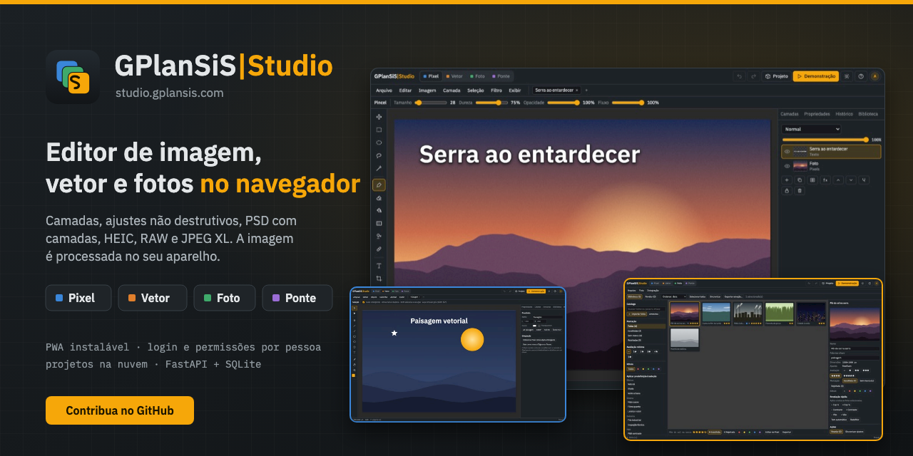
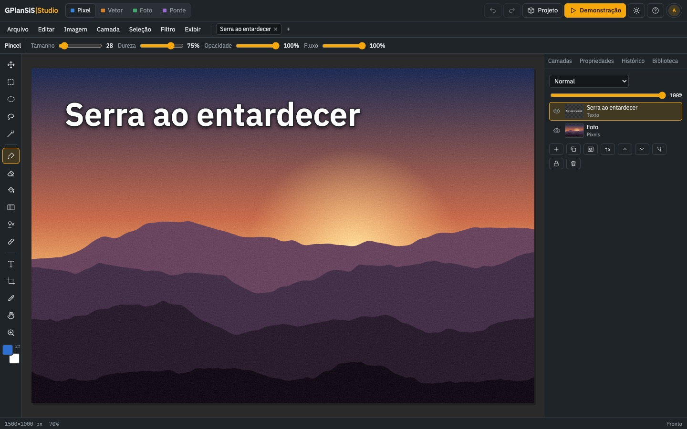
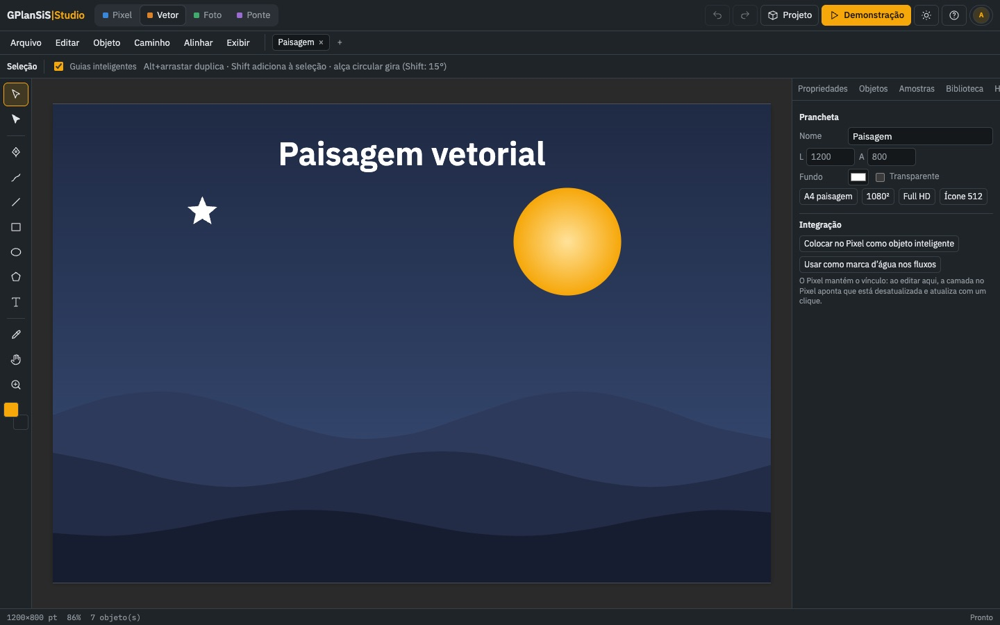
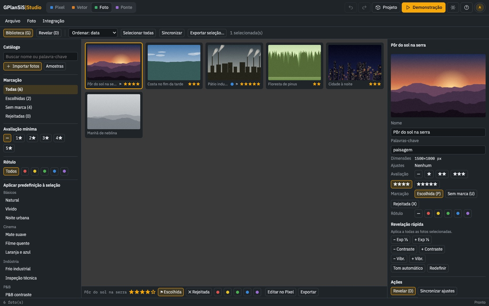
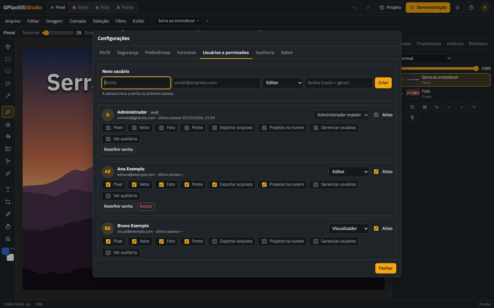
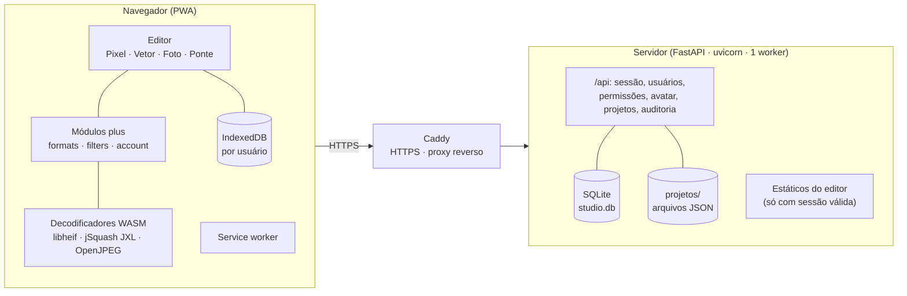

<p align="center">
  <a href="https://studio.gplansis.com"></a>
</p>

<p align="center">
  <a href="https://studio.gplansis.com"></a>
  
  <a href="LICENSE"><">
  
  
  <a href="CONTRIBUTING.md"></a>
</p>

<h1 align="center">GPlanSiS|Studio</h1>

<p align="center"><b>Edição de imagem, ilustração vetorial e revelação de fotos — tudo no navegador, sem instalar nada.</b></p>

<p align="center">
  <a href="https://studio.gplansis.com"><b>➜ Abrir o Studio em studio.gplansis.com</b></a>
  &nbsp;·&nbsp; <a href="#como-rodar-localmente">Rodar localmente</a>
  &nbsp;·&nbsp; <a href="#contribua">Contribuir</a>
</p>

---

## O que é

O **GPlanSiS|Studio** é um editor de imagem completo que roda no navegador, com quatro módulos integrados:

| Módulo | Para quê |
|---|---|
| **Pixel** | edição de imagem por camadas: pincel, seleções, texto, máscaras, camadas de ajuste e filtros não destrutivos |
| **Vetor** | ilustração vetorial com pranchetas, caminhos, formas, texto, alinhamento e exportação |
| **Foto** | catálogo com avaliação, marcação e rótulos, revelação rápida, predefinições e sincronização de ajustes |
| **Ponte** | integração entre os módulos: objetos inteligentes vinculados, biblioteca compartilhada, paleta, vetorização e fluxos em lote |

**O processamento de imagem acontece no aparelho de cada pessoa** — a imagem não sai do navegador. O servidor só cuida de acesso, usuários, permissões, preferências, avatar e dos projetos que a pessoa escolhe salvar na nuvem.

## Funcionalidades

**Formatos de leitura** — praticamente todo formato de imagem atual:

| Formato | Como é lido |
|---|---|
| JPEG, PNG, APNG, GIF, WebP, AVIF, BMP, ICO/CUR, SVG/SVGZ | nativo do navegador |
| HEIC/HEIF | nativo no Safari; libheif (WebAssembly) nos demais |
| JPEG XL | nativo no Safari; jSquash (WebAssembly) nos demais |
| JPEG 2000 (.jp2, .j2k, .jpx, .jph) | nativo no Safari; OpenJPEG (WebAssembly) nos demais |
| TIFF (8/16 bits, várias páginas) | UTIF.js |
| PSD/PSB | ag-psd — **abre com todas as camadas** (opacidade, mesclagem, visibilidade) |
| RAW (DNG, CR2, CR3, NEF, ARW, ORF, RAF, RW2, PEF, SRW…) | prévia JPEG embutida, com a orientação da câmera |
| TGA, QOI, PBM/PGM/PPM/PAM/PFM, Radiance HDR, PCX | decodificadores próprios |
| GIF/WebP/APNG animados | quadros como camadas (Chrome/Edge) |

**Exportação:** PNG, JPEG, WebP, AVIF (onde o navegador codifica), **PSD com camadas**, TIFF, BMP, ICO multitamanho e QOI.

**Edição avançada** — não destrutiva, empilhável e utilizável como camada de ajuste com máscara:

- **Ajustes:** Exposição, Vibração, Temperatura e matiz, Sombras e realces, Equilíbrio de cores, Mixer de canais, Filtro de foto, Mapa de degradê, Tom automático, CLAHE, Remover névoa, Tonalização HDR, LUT 3D (`.cube`).
- **Filtros:** Desfoque de superfície, Redução de ruído, Mediana, Passa-alta, Clareza, Desfoque de movimento, Desfoque radial, Tilt-shift, Correção de lente (distorção, aberração cromática, vinheta), Redemoinho, Ondulação, Pintura a óleo, Meio-tom, Brilho difuso, Esboço a lápis.
- **Ferramentas:** Preenchimento inteligente para remover o que está selecionado (`Shift+Del`), Histograma, abrir animação como camadas.

**Contas e permissões**

- Login com e-mail e senha; troca obrigatória no primeiro acesso.
- Papéis **administrador**, **editor** e **visualizador**, com ajuste fino por pessoa: Pixel · Vetor · Foto · Ponte · Exportar arquivos · Projetos na nuvem · Gerenciar usuários · Ver auditoria.
- Um administrador **master** (definido por variável de ambiente) que não pode ser excluído, desativado nem rebaixado.
- Segurança: senha com **scrypt**, cookie de sessão HttpOnly/Secure/SameSite=Lax, cabeçalho anti-CSRF em toda escrita, limite de 8 tentativas de login por 15 min (por IP e por e-mail), sessões ativas revogáveis e **auditoria** de logins, falhas e alterações.

**Configurações por conta** — perfil com foto (recorte; aceita HEIC do iPhone), segurança, preferências (tema, módulo inicial, borda máxima ao importar, formato e qualidade padrão de exportação, salvamento automático) que acompanham a pessoa em qualquer aparelho.

**Projetos na nuvem** — `Arquivo › Projetos na nuvem…` (`Ctrl+Shift+S`). O trabalho local (salvamento automático no IndexedDB) fica **separado por usuário** no navegador.

**PWA e celular** — instalável (manifest, ícones maskable, apple-touch, service worker que só guarda o editor depois do login e nunca a API). No celular, diálogos viram painéis de baixo para cima, alvos de toque maiores e sem rolagem lateral.

## Telas

| Pixel | Vetor |
|---|---|
|  |  |
| **Foto** | **Usuários e permissões** |
|  |  |

<sub>Capturas feitas numa instância local com dados fictícios (projeto de demonstração do próprio editor).</sub>

## Arquitetura



**Como o build funciona.** O editor original (`editor/GPlanSiS-Studio.html`, um único arquivo HTML) **não é editado à mão**. O `build.py` aplica pontos de integração pequenos e verificados — cada troca precisa casar exatamente o número de vezes esperado, senão o build para — e injeta os módulos de `web/plus/` (formatos, filtros, conta). O resultado vai para `dist/web/`, que é o que o servidor entrega.

## Stack

- **Editor:** HTML/CSS/JavaScript puro (sem framework, sem bundler), Canvas 2D, IndexedDB, Service Worker.
- **Bibliotecas no navegador:** ag-psd, UTIF.js, pako, libheif-js, jSquash (JPEG XL), OpenJPEG (`@cornerstonejs/codec-openjpeg`) servidos de `web/vendor/`; JSZip e polygon-clipping carregados sob demanda de CDN (cdnjs/jsDelivr); fontes IBM Plex embutidas.
- **Servidor:** Python 3, FastAPI, uvicorn, SQLite (biblioteca padrão), scrypt (`hashlib`).
- **Produção:** systemd + Caddy (HTTPS e proxy reverso).
- **Testes:** `tools/testar_api.py` (API, sem dependências) e `tools/prova_navegador.mjs` (Chrome real via puppeteer-core).

## Como rodar localmente

Requisitos: **Python 3.10+** e um navegador moderno (Chrome, Edge, Firefox ou Safari).

```bash
git clone https://github.com/SSBianchiplan/studio.git
cd studio

# 1. gerar o editor integrado em dist/web
python3 build.py

# 2. ambiente do servidor
python3 -m venv .venv
.venv/bin/pip install -r server/requirements.txt

# 3. variáveis (valores fictícios, para teste local)
cp .env.example .env
set -a; . ./.env; set +a

# 4. subir
.venv/bin/uvicorn --app-dir server app:app --host 127.0.0.1 --port 8972
```

Abra <http://127.0.0.1:8972>, entre com o `STUDIO_MASTER_EMAIL` e o `STUDIO_MASTER_PASSWORD` do seu `.env` e defina a nova senha (o sistema exige a troca no primeiro acesso). Use o botão **Demonstração** para carregar um projeto de exemplo.

> `STUDIO_COOKIE_SECURE=0` é necessário para testar em `http://`; em produção (HTTPS) use `1`.

### Testes

```bash
# API: 39 verificações contra um servidor de teste com banco descartável
STUDIO_DATA=/tmp/studio-teste STUDIO_COOKIE_SECURE=0 STUDIO_MASTER_EMAIL=contato@gplansis.com \
  STUDIO_MASTER_PASSWORD='Teste-Master-2026' .venv/bin/uvicorn --app-dir server app:app --port 8972 &
python3 tools/testar_api.py http://127.0.0.1:8972 Teste-Master-2026

# navegador real (login, formatos, filtros, exportação, nuvem, permissões, PWA, celular)
npm i puppeteer-core
BASE=http://127.0.0.1:8972 EMAIL=... SENHA=... AMOSTRAS=<pasta com imagens> SAIDA=<pasta> node tools/prova_navegador.mjs
```

## Estrutura de pastas

```
editor/GPlanSiS-Studio.html   editor original (Pixel, Vetor, Foto, Ponte) — fonte do build, não é editado à mão
build.py                      gera dist/web: editor + pontos de integração + módulos de web/plus
web/
  login.html                  página de login (pública)
  manifest.webmanifest, sw.js PWA
  icons/                      logo, ícones 192/512, maskable, apple-touch, favicon
  plus/                       formats.js · filters.js · account.js · plus.css
  vendor/                     bibliotecas de terceiros (com os textos de licença)
server/
  app.py                      FastAPI + SQLite: sessão, usuários, permissões, avatar, preferências, nuvem, auditoria
  requirements.txt
deploy/
  enviar.sh                   build + envio + serviço + Caddy (idempotente, com backup e validação)
  gplansis-studio.service     unidade systemd (usuário próprio, sistema de arquivos protegido)
  studio.caddy                bloco do Caddy (HTTPS, limite de 210 MB para projetos)
  env.exemplo                 modelo do .env de produção
tools/
  testar_api.py               prova da API
  prova_navegador.mjs         prova de ponta a ponta no Chrome
  gerar_icones.mjs            rasteriza os SVG da marca nos tamanhos de ícone
```

## Variáveis de ambiente

| Variável | Para quê | Padrão |
|---|---|---|
| `STUDIO_DATA` | pasta de dados (banco SQLite e projetos) | `server/dados` |
| `STUDIO_WEB` | pasta dos estáticos gerados pelo build | `dist/web` |
| `STUDIO_MASTER_EMAIL` | e-mail do administrador master | `contato@gplansis.com` |
| `STUDIO_MASTER_PASSWORD` | senha inicial do master (só no primeiro arranque; sem ela, uma senha aleatória é gravada em `STUDIO_DATA/senha-inicial-master.txt`) | — |
| `STUDIO_COOKIE_SECURE` | `1` em produção (HTTPS), `0` em teste local | `1` |

## Publicar

`deploy/enviar.sh` gera o build, envia para o servidor (`HOST`, via SSH), cria usuário de sistema, venv, serviço systemd e bloco do Caddy no primeiro envio e, nos seguintes, só troca os arquivos e reinicia o serviço. A versão anterior dos estáticos fica em `web.antigo/` para reverter. Backup dos dados: a pasta `STUDIO_DATA` (`studio.db` + `projetos/`).

## Limites conhecidos

- RAW usa a prévia embutida da câmera (resolução total na maioria dos modelos atuais); não faz revelação do sensor.
- AVIF só é exportado onde o navegador codifica; o Chrome atual não codifica.
- O processamento roda no aparelho: no iPhone/iPad o limite de canvas é ~16,7 MP; nos demais o padrão é 6.000 px na borda maior (ajustável até 12.000 em Preferências).
- As permissões de módulo e de exportação valem na interface do editor; usuários, auditoria e nuvem são validados no servidor.

## Contribua

O Studio é feito pela GPlanSiS e **quer colaboradores** — de quem desenha filtros a quem caça bug no Safari. Dá para ajudar em:

- **Formatos:** revelação RAW de verdade (hoje só a prévia embutida), exportação AVIF/JPEG XL por WebAssembly onde o navegador não codifica, EXR.
- **Edição:** novos ajustes e filtros não destrutivos, desempenho dos filtros pesados (Web Workers, OffscreenCanvas, WebGL).
- **Permissões no servidor:** hoje módulos e exportação são aplicados na interface; levar mais regras para o servidor.
- **Testes:** casos novos em `tools/testar_api.py`, amostras de formatos raros para `tools/prova_navegador.mjs`.
- **Acessibilidade e celular:** navegação por teclado, leitores de tela, telas pequenas.
- **Documentação e tradução** da interface.

**Boas primeiras issues:** um decodificador simples novo em `web/plus/formats.js`; um filtro novo em `web/plus/filters.js`; uma verificação a mais em `tools/testar_api.py`; correções de texto e de layout no celular.

Leia o [guia de contribuição](CONTRIBUTING.md), o [código de conduta](CODE_OF_CONDUCT.md) e, para falhas de segurança, a [política de segurança](SECURITY.md). Ideias e dúvidas: abra uma [issue](https://github.com/SSBianchiplan/studio/issues/new/choose).

## Licença

Código próprio sob a **[licença MIT](LICENSE)** — Copyright (c) 2026 GPlanSiS.

As bibliotecas de terceiros mantêm as próprias licenças (textos em `web/vendor/LICENSE-*`): polygon-clipping, JSZip, UTIF.js, pako, ag-psd, `@cornerstonejs/codec-openjpeg` (MIT) · libheif (LGPL-3.0) · jSquash JPEG XL (Apache-2.0) · OpenJPEG (BSD-2-Clause) · fontes IBM Plex (SIL OFL 1.1).

## Créditos

Desenvolvido pela **[GPlanSiS](https://gplansis.com)** · contato: [contato@gplansis.com](mailto:contato@gplansis.com)

<p align="center"><a href="https://studio.gplansis.com"><b>studio.gplansis.com</b></a></p>
